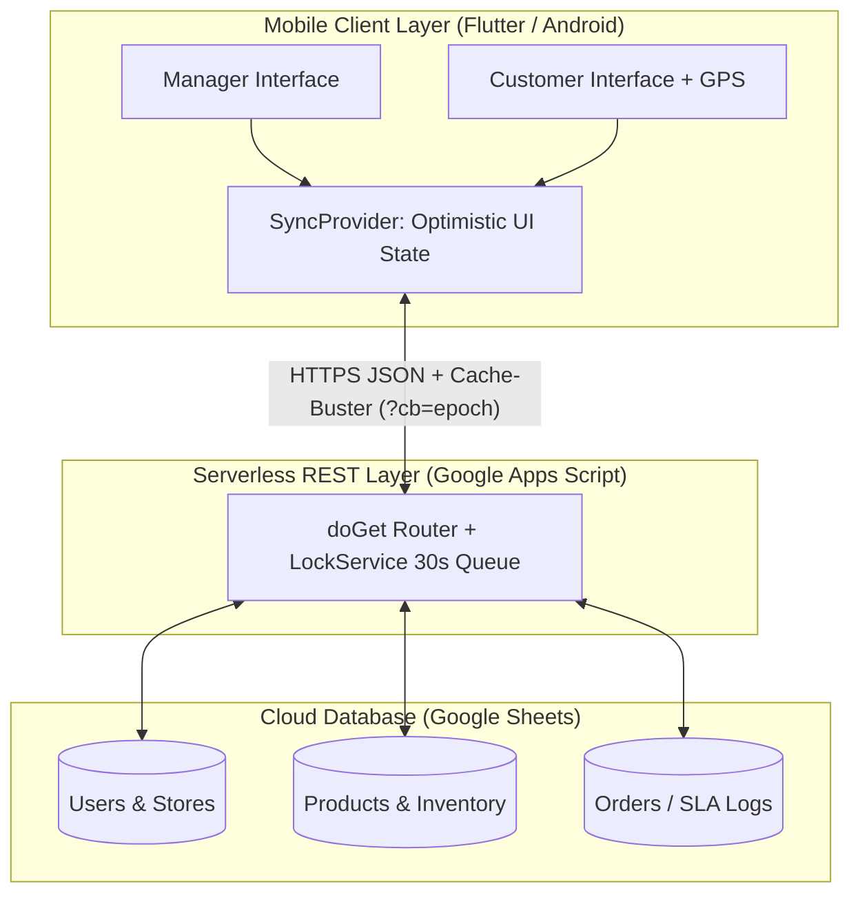

# Spatially-Aware Distributed Retail Management System (Smart Retail Hub)


> **Integration of Serverless Multi-Tenant Architecture and Time-Bound Resource Allocation Protocols over Mobile Networks**  
> *M.Sc. in Computer Science (Mobile Computing) Project — Ramakrishna Mission Vivekananda Centenary College (RKMVCC), Rahara*

---

## Overview

**Smart Retail Hub** is a location-aware mobile retail management application designed to keep physical store inventory synchronized in real time across multiple branches. Built with a **Flutter** mobile frontend, a stateless **Google Apps Script** REST API, and a normalized **5-table Google Sheets** backend, it eliminates the cost and maintenance of dedicated monolithic servers while solving core Mobile Computing challenges—including wireless network latency, mobile OS HTTP caching, GPS proximity routing, and concurrent write conflicts.

---

## Key Features

### Dual-Role Mobile Interfaces
* **Manager (Provider) Panel:**
  * Multi-tenant login isolated by `owner_id`.
  * Add or remove physical store branches (with GPS coordinates and store helpline).
  * Manage global and local product catalogs.
  * Instant `+` / `-` live inventory adjustments powered by Optimistic UI.
  * Real-time reservation dashboard displaying customer bookings and active ETA penalty windows.
* **Customer Panel:**
  * Live GPS lock via `geolocator` to check real-time stock at nearby stores.
  * **Out-of-Stock Fallback Routing:** Automatically scans alternative in-stock branches under the same `owner_id`, calculates great-circle distances using the **Haversine Formula**, sorts them in $O(n \log n)$ time, and launches one-tap **Google Maps** turn-by-turn directions.
  * **Time-Bound SLA Reservation:** Reserves items by declaring an Estimated Time of Arrival (ETA) in hours and confirming an upfront $5.00 deposit (credited to the final bill on timely arrival, or forfeited with automatic inventory rollback if missed).

### Core Mobile Computing & Engineering Highlights
* **Optimistic UI State Management (~16 ms):** `SyncProvider` (`ChangeNotifier`) updates local UI state immediately on the next 60 Hz display frame while syncing asynchronously in the background—with automatic rollback if the network call fails.
* **Cache-Busting (`&cb=epoch`):** Appends the current UNIX millisecond timestamp to every REST URI to defeat aggressive Android HTTP `GET` caching (`304 Not Modified`) and prevent phantom inventory desynchronization.
* **Concurrency Control:** Uses Google Apps Script's `LockService.getPublicLock()` with a 30-second synchronized queue to serialize overlapping writes.
* **Smart Fallback Key Matching:** Enforces Layer-7 referential integrity across both generated `product_id` timestamps and legacy `sku` codes, preventing empty-string null-matching bugs.

---

## System Architecture



---

## Database Schema (5-Table Normalized Google Sheets)

| Table (Sheet) | Primary Key | Foreign Key(s) | Purpose |
| :--- | :--- | :--- | :--- |
| **`Users`** | `owner_id` / User ID | — | Stores credentials and roles (`provider`, `customer`). |
| **`Stores`** | `store_id` | `owner_id` | Stores branch names, latitude/longitude coordinates, and helplines. |
| **`Products`** | `product_id` / `sku` | `owner_id` | Global and local product catalog metadata (name, price, SKU). |
| **`Inventory`** | (`store_id`, `product_id`) | `store_id`, `product_id` | Junction table tracking per-branch stock `quantity`. |
| **`Orders`** | `order_id` | `store_id`, `product_id` | Logs reservations, `customer_name`, declared `eta`, and SLA status. |

---

## Tech Stack

| Layer | Technology / Package |
| :--- | :--- |
| **Mobile Frontend** | Flutter SDK (Dart), tested on Android 10 (Moto e7 Plus) |
| **State Management** | `ChangeNotifier` (`SyncProvider`) |
| **Location & Routing** | `geolocator`, `google_maps_flutter`, `url_launcher` |
| **Networking** | Dart `http` (Stateless HTTPS / JSON) |
| **Serverless Backend** | Google Apps Script (`Code.gs`) + `LockService` |
| **Cloud Database** | Google Sheets (5-table pseudo-relational schema) |

---

## Performance Benchmarks

| Metric | Traditional Monolithic (REST + SQL) | Proposed Serverless (Flutter + Apps Script) |
| :--- | :--- | :--- |
| **State Control** | Pessimistic (blocks UI) | **Optimistic UI (instant local mutation)** |
| **Perceived UI Latency** | 300 ms – 2,500 ms | **~16 ms (1 frame @ 60 Hz)** |
| **Stale Cache Risk** | Moderate / High | **Zero (millisecond cache-busting)** |
| **Hosting Cost** | Continuous VM billing | **Zero-cost event-driven execution** |

---

## Getting Started

### Prerequisites
* [Flutter SDK](https://docs.flutter.dev/get-started/install) (`>= 3.1.0`)
* Android Studio or VS Code with Android SDK
* A Google Account (for Google Sheets & Google Apps Script)

### 1. Backend Setup (Google Sheets + Apps Script)
1. Create a new Google Sheet with five tabs named: `Users`, `Stores`, `Products`, `Inventory`, and `Orders`.
2. Open **Extensions → Apps Script**, paste your `Code.gs` backend script, and save.
3. Click **Deploy → New deployment → Web app**:
   * **Execute as:** `Me`
   * **Who has access:** `Anyone`
4. Copy the generated Web App URL.

### 2. Frontend Setup (Flutter)
```bash
# Clone the repository
git clone https://github.com/<your-username>/<your-repo-name>.git
cd <your-repo-name>

# Install dependencies
flutter pub get

# Generate custom launcher icons (optional)
dart run flutter_launcher_icons

# Run on a connected Android device
flutter run

# Build release APK
flutter build apk --release
```
*(Update the API endpoint constant in your Dart provider/service file with your deployed Google Apps Script Web App URL before building.)*

---

## Future Scope
* **Live Payment Gateway:** Integrate Razorpay, Stripe, or UPI webhooks for automated deposit holds and forfeiture escrow.
* **Background Geofencing & Traffic-Aware ETA:** Upgrade to Android's Fused Location Geofencing API (50m radius check-in) and Google Maps Distance Matrix API.
* **Enterprise Scaling:** Migrate to Firebase Firestore / AWS DynamoDB with WebSockets for real-time push sync.
* **Security:** Upgrade authentication to OAuth 2.0 + JWT and add dynamic counter QR/NFC check-in to prevent GPS spoofing.

---

## Project Team & Supervision

**Submitted by (M.Sc. Computer Science, RKMVCC):**
* **Rahul Roy** (`A01-1122-217-006-2025`)
* **Sankha Ghosh** (`A01-1112-217-004-2025`)
* **Aniket Dutta** (`A01-1112-217-012-2025`)
* **Bishnupada Sahoo** (`A01-1151-217-019-2025`)

**Under the Supervision of:**
* **Shri Manas Pal**
* **Prof. Soumya Paul**

*Department of Computer Science, Ramakrishna Mission Vivekananda Centenary College, Rahara, West Bengal, India.*
